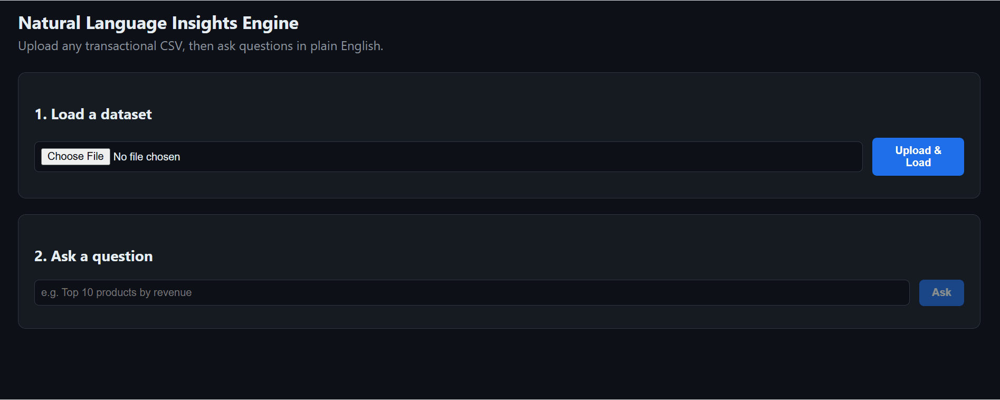
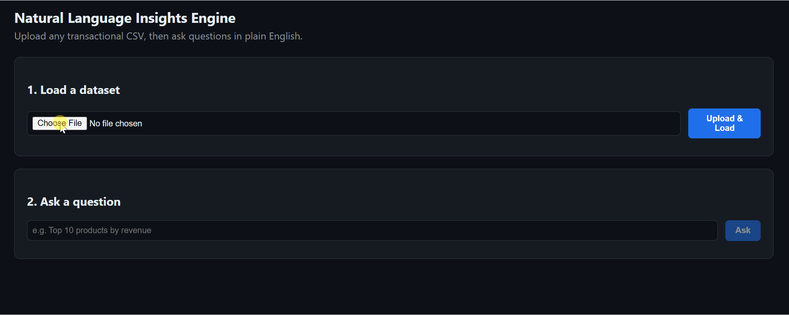

# Natural Language Insights Engine

A small, production-minded NL→SQL service for transactional CSVs. Upload an unfamiliar CSV, let the system infer its schema, ask a plain-English question, and receive either a database-backed answer or an explicit refusal when the data cannot support the question.

**Take-home focus:** the analytics are intentionally simple; the engineering around ingestion, schema inference, async jobs, guardrails, API design, tests, setup, and extensibility is the main point.

## What is included

- **Generic CSV ingestion:** DuckDB infers the header, delimiter, and column types from the uploaded file. No sample-dataset column names are embedded in application prompts, SQL, or configuration.
- **Schema context:** the LLM receives only the uploaded dataset's generated profile: columns, types, null counts, cardinality, samples, and applicable ranges.
- **Async API:** ingestion and NL queries return `202` + `job_id`; callers can poll or subscribe to SSE status updates.
- **Guarded NL→SQL:** generated SQL must be a single `SELECT`/`WITH` query, reference only the current dataset table, and pass deterministic safety checks before execution.
- **Defense in depth:** SQL validation + a DuckDB read-only connection + a query timeout.
- **Deterministic answers:** final numbers/text are formatted from the actual SQL result; there is no second LLM call that can rewrite the numbers.
- **Refusal path:** unsupported questions return `answerable=false` with a reason instead of inventing a result.
- **Real HTTP API + UI:** FastAPI backend and a zero-build vanilla-JS frontend.
- **Tests + CI:** unit tests cover schema inference, SQL safety, and the async API flow; GitHub Actions runs the test suite on push/PR.
- **Evaluation harness:** `eval/questions.json` contains answerable and intentionally unanswerable cases, including a differently named CSV.
- **Walkthrough GIFs:** one shows a normal query; the second shows a previously unseen CSV schema being loaded and queried.

## Requirement checklist

| Take-home requirement | Status | Where |
|---|---|---|
| Repeatable CSV → queryable pipeline | Done | `app/db.py`, `POST /ingest` |
| Any transactional CSV / no code changes | Done | generic DuckDB inference + `build_schema_context()` |
| Infer schema/types from the file | Done | `read_csv_auto(..., sample_size=-1)` + profile |
| Async ingestion and queries | Done | `app/jobs.py`, `202 + job_id` |
| Poll or stream job status | Done | `GET /jobs/{id}`, `GET /jobs/{id}/stream` |
| Plain-English Q&A | Done | `app/nl_query.py`, `app/llm_client.py` |
| Refuse when data is insufficient | Done | model answerability + SQL validation + eval cases |
| Real HTTP API / validation / status codes | Done | FastAPI routes + Pydantic models |
| Structured errors / no stack traces | Done | global exception handler + route-level HTTP errors |
| Working UI | Done | `frontend/index.html` |
| One-command local setup | Done* | `scripts/setup.sh` |
| Tests | Done | `tests/` |
| CI on push | Done | `.github/workflows/ci.yml` |
| Guardrail evaluation | Done | `eval/questions.json`, `eval/run_eval.py` |
| README | Done | this file |
| System design + architecture image | Done | `docs/SYSTEM_DESIGN.md`, `docs/architecture.svg` |
| Short GIFs, including second CSV load | Done | `docs/gifs/` |

\* The setup script assumes Python and an LLM backend are already available. The default path uses local Ollama; the README also documents an OpenAI-compatible option. The application itself has no cloud dependency.

## Quickstart — local

### Prerequisites

- Python **3.11+**
- For the default local model: [Ollama](https://ollama.com)

### One command

From the repository root:

```bash
./scripts/setup.sh
```

The script creates `.venv`, installs dependencies, creates `.env` if needed, prepares storage, attempts to pull the configured Ollama model, and starts the API at:

**http://localhost:8000**

Open that URL for the UI.

If Ollama is installed but not already running, start it in another terminal first:

```bash
ollama serve
```

Then rerun `./scripts/setup.sh`.

### Manual setup

```bash
python3 -m venv .venv
source .venv/bin/activate
pip install -r requirements.txt
cp .env.example .env
ollama pull qwen2.5-coder:7b-instruct
uvicorn app.main:app --host 0.0.0.0 --port 8000
```

For Windows PowerShell, activate with `.venv\Scripts\Activate.ps1` and run `uvicorn app.main:app --host 0.0.0.0 --port 8000`.

## Quickstart — Docker

```bash
docker compose up --build -d
docker compose exec ollama ollama pull qwen2.5-coder:7b-instruct
```

Then open **http://localhost:8000**. The model pull is intentionally separate because downloading several GB of model weights during an image build is slow and makes rebuilds expensive.

## LLM configuration

The default is local Ollama:

```text
LLM_PROVIDER=ollama
OLLAMA_BASE_URL=http://localhost:11434
OLLAMA_MODEL=qwen2.5-coder:7b-instruct
```

To use an OpenAI-compatible endpoint instead:

```text
LLM_PROVIDER=openai_compatible
OPENAI_BASE_URL=https://api.openai.com/v1
OPENAI_API_KEY=<your-key>
OPENAI_MODEL=gpt-4o-mini
```

The rest of the application does not change. See `app/llm_client.py` for the provider boundary.

## Using the UI

1. Open **http://localhost:8000**.
2. Upload `data/sample_retail.csv`.
3. Wait for ingestion to finish and inspect the inferred schema.
4. Ask questions such as:
   - `Top 10 products by revenue`
   - `Net revenue in December 2010`
   - `How many customers bought only once, and what share of revenue do they represent?`
   - `Which products are most often bought together?`
5. Try the deliberately different schema in `data/sample_orders_different_schema.csv`. It uses names such as `order_id`, `item_name`, `qty`, `price_usd`, `client_email`, and `region`; no application code changes are required.
6. Try an unsupported question such as `What is the average customer's shoe size?`. The expected behavior is a refusal.

## API examples

### 1. Ingest

```bash
curl -s -F "file=@data/sample_retail.csv" http://localhost:8000/ingest
```

Response:

```json
{"job_id":"...","status":"queued","poll_url":"/jobs/...","stream_url":"/jobs/.../stream"}
```

### 2. Poll

```bash
curl -s http://localhost:8000/jobs/<job_id>
```

When the job is `done`, read `result.dataset_id`.

### 3. Ask a question

```bash
curl -s -X POST http://localhost:8000/query \
  -H "Content-Type: application/json" \
  -d '{"dataset_id":"<dataset_id>","question":"Top 10 products by revenue"}'
```

Poll the returned job in the same way.

### 4. Stream status

```bash
curl -N http://localhost:8000/jobs/<job_id>/stream
```

### API documentation

FastAPI's interactive docs are available at **http://localhost:8000/docs**.

## Tests and CI

Run the local test suite:

```bash
pytest -v
```

The tests do **not** require a live LLM. The API integration test injects a deterministic fake LLM, while the NL-query tests exercise answerable, refusal, and unsafe-SQL paths.

GitHub Actions runs the same tests on push and pull request via `.github/workflows/ci.yml`.

## Evaluation / guardrails

With the API already running:

```bash
python eval/run_eval.py
```

The harness:

- ingests each fixture once;
- submits questions through the real async API;
- checks exact values where a deterministic scalar is appropriate;
- checks that expected answerable questions actually return rows;
- checks that intentionally unsupported questions are refused;
- exercises both the sample retail schema and a differently named transactional schema.

This is deliberately separate from unit tests: it is a small end-to-end smoke test of the NL→SQL boundary.

## Architecture

See **[`docs/SYSTEM_DESIGN.md`](docs/SYSTEM_DESIGN.md)** for:

- component ownership;
- end-to-end request flow;
- unfamiliar-file schema inference;
- failure modes and concurrency behavior;
- the major decisions and rejected alternatives;
- what would be built next;
- a walkthrough-ready feature-extension example.

## Demo GIFs

### Normal query



### Unseen CSV loaded and queried



The second GIF shows `ecommerce_sales_analytics_5000.csv` being loaded, its different schema being inferred, and a query being answered. The recording is intentionally captured after the answer is produced so the GIF stays short.

## Deliberate scope cuts

This is a six-hour exercise, so I did **not** add:

- Redis/Celery or another external job broker;
- authentication;
- cloud deployment;
- a persistent multi-process job store;
- a semantic layer;
- tracing/LLM observability;
- charts or a frontend build system.

These are discussed as follow-on work in the system design document rather than being half-implemented.

## Known limitations

- The in-memory job manager is process-local and loses jobs on restart. A persistent queue/store is the first production scaling step.
- Very wide CSVs can make the schema prompt large.
- Semantic fields such as `col_7` cannot be reliably inferred if their meaning is not represented by names or values; refusal is preferable to guessing.
- A transactional CSV without an order/basket key cannot support "bought together" analysis.
- Messy CSV typing can still produce `VARCHAR` columns; the generated schema tells the model the actual type so it can use explicit casts when appropriate.
- The default local LLM is a practical demo choice, not a guarantee of perfect semantic SQL on every arbitrary dataset.

## Project hygiene

Generated databases/uploads and local secrets are ignored by `.gitignore`. The submitted source does not include a resume or author name in application/docs content.
