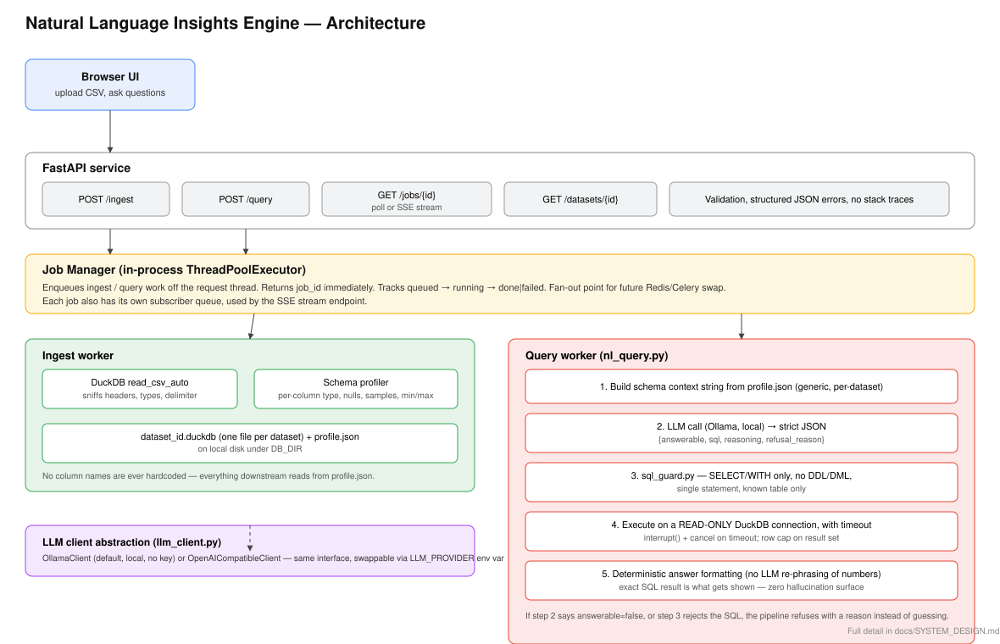

# System Design — Natural Language Insights Engine



## 1. Goal and design principles

The system turns an unfamiliar transactional CSV into a queryable dataset and provides a guarded natural-language query interface around it.

The key principle is **data-derived context, deterministic execution**:

1. infer the schema from the uploaded file;
2. give the model only that generated schema/profile and the user's question;
3. let the model propose SQL, not the final numbers;
4. validate the SQL before execution;
5. execute against a read-only DuckDB connection;
6. format the returned rows deterministically.

This keeps the LLM in the semantic translation role while the database remains the source of truth for numeric results.

## 2. Components and ownership

| Component | File(s) | Owns |
|---|---|---|
| **FastAPI service** | `app/main.py`, `app/routes/*` | HTTP contracts, request validation, status codes, routing, global error sanitization. |
| **Job manager** | `app/jobs.py` | `job_id`, lifecycle state, bounded worker pool, polling, SSE subscribers. |
| **DuckDB layer** | `app/db.py` | CSV ingestion, type inference, dataset storage, schema profile, read-only query connection. |
| **LLM client** | `app/llm_client.py` | Provider-specific HTTP calls and JSON parsing. Ollama and OpenAI-compatible endpoints share one interface. |
| **NL→SQL pipeline** | `app/nl_query.py` | Schema-context construction, prompt contract, answerability handling, SQL execution, deterministic answer formatting. |
| **SQL guard** | `app/sql_guard.py` | Deterministic pre-execution SQL validation. |
| **Frontend** | `frontend/index.html` | CSV upload, job polling, schema display, question submission, result/refusal display. |
| **Evaluation** | `eval/*` | Repeatable end-to-end smoke cases and expected behavior. |

## 3. Request path: input to answer

### Ingestion

1. Browser/client sends `POST /ingest` with a CSV.
2. FastAPI validates the extension and upload size, stores a temporary upload, and immediately submits an ingestion job.
3. The caller receives `202` and a `job_id`.
4. A worker calls `ingest_csv()`.
5. DuckDB `read_csv_auto(..., header=True, sample_size=-1)` infers the file's structure and creates a fresh `dataset` table.
6. The application profiles every column: inferred DuckDB type, null count, distinct count, sample values, and min/max where meaningful.
7. The profile is persisted next to the DuckDB file.
8. The temporary upload is removed after the ingestion job completes.
9. The job becomes `done` with `dataset_id`, row count, and schema information.

### Question answering

1. Client sends `POST /query` with `dataset_id` and a natural-language question.
2. FastAPI verifies the dataset exists and submits a query job.
3. The worker builds a schema context from the stored profile. The raw CSV is not sent to the LLM.
4. The LLM is asked for strict JSON containing `answerable`, `sql`, `reasoning`, and `refusal_reason`.
5. If the model says the question is not answerable, the pipeline stops and returns a refusal.
6. If SQL is returned, `validate_sql()` checks that it is one `SELECT`/`WITH` statement, contains no mutating/administrative SQL keywords, and references only the current `dataset` table plus self-defined CTEs.
7. Valid SQL runs through a DuckDB **read-only** connection with a timeout.
8. Results are capped at `MAX_RESULT_ROWS`.
9. The answer text is formatted from the actual SQL rows. There is no second LLM call to restate the numbers.
10. The job becomes `done`; the caller retrieves the result through polling or SSE.

## 4. Schema context for an unfamiliar CSV

The schema context is built only after ingestion. For each uploaded column, the system records:

- original column name;
- DuckDB-inferred type;
- null count;
- distinct count;
- up to five real non-null sample values;
- min/max for numeric/date/time-like types.

Example context for a hypothetical file is conceptually:

```text
Table name: dataset
Row count: 5000
Columns:
- "qty" (BIGINT) nulls=0 distinct=7 samples=[1, 5, 6, 7, 4]
- "unit_price" (DOUBLE) nulls=0 distinct=4788 samples=[47.74, 139.87, 564.6]
- "region" (VARCHAR) nulls=0 distinct=4 samples=[North, South, East, West]
```

No UCI-specific column names are needed by the application. The model must reason from whatever names/types/samples arrive in this profile.

### Where this breaks

1. **Opaque semantic names.** If the file contains `x1`, `x2`, and `x3`, the system cannot safely infer that one is quantity and another is price. Refusal is safer than invented semantics.
2. **Missing business keys.** "Products bought together" requires a basket/order identifier. A line-item file without such a key cannot support that analysis.
3. **Messy types.** A mostly numeric column containing strings may be inferred as `VARCHAR`. The model sees the actual type and must use safe casts if appropriate.
4. **Very wide files.** The profile grows with column count and can eventually consume too much LLM context. A production version should rank/select relevant columns or introduce a semantic catalog.
5. **Ambiguous business definitions.** "Revenue" can mean gross sales, net of discounts, or another organization-specific metric. The current system uses schema evidence and common transactional conventions; a production semantic layer would make this explicit.

## 5. Async jobs and concurrent load

The current implementation uses a bounded `ThreadPoolExecutor` with `MAX_JOB_WORKERS` (default 4). This deliberately satisfies the take-home contract without introducing Redis/Celery during a six-hour exercise.

### Under concurrent load

- Up to the configured number of jobs execute concurrently.
- Additional jobs remain queued in the executor.
- The API thread returns immediately after job submission.
- Each job has isolated result/error state.
- Query execution itself has a timeout.
- SSE subscribers receive lifecycle events from the job object.

### Partial failure behavior

- An ingestion failure marks only that ingestion job `failed`; the API process remains available.
- An LLM failure becomes an `answerable=false` result with an explanatory refusal/error reason.
- Unsafe SQL becomes a refusal before database execution.
- A query timeout interrupts the DuckDB connection and returns a controlled result.
- Unexpected API exceptions are logged server-side and sanitized to a generic HTTP 500 response.

### Production evolution

The first production change would be **Redis + RQ/Celery (or a managed queue) plus a persistent job table**. That would make jobs survive process restarts and allow multiple API/worker instances to share work.

## 6. Guardrails and correctness

There are three independent execution controls:

1. **LLM answerability:** the model must explicitly say whether the schema can answer the question.
2. **Static SQL guard:** only a single `SELECT`/`WITH` query is accepted; mutating/admin SQL is rejected; unknown table references are rejected.
3. **Read-only database connection:** even if a generated statement slips past the static checker, the execution connection cannot mutate the DuckDB file.

A fourth operational control is the **query timeout**.

The final answer is not generated by the LLM. The application formats the database rows directly. This means a model cannot turn `12345.67` into a different number during answer phrasing.

### Evaluation strategy

`eval/questions.json` intentionally mixes:

- deterministic exact-value checks;
- answerable questions where the pipeline must produce rows;
- refusal cases for missing concepts.

The harness calls the real HTTP API and waits on its async jobs, so it tests more than a pure function.

## 7. Biggest decisions and alternatives rejected

### Decision 1 — DuckDB instead of Postgres/SQLite

**Why:** DuckDB can infer CSV structure, query locally, and persist a dataset without a separate database service. This makes arbitrary-file support and 15-minute setup much simpler.

**Rejected:** Postgres because it adds schema/loading infrastructure that does not improve this take-home; SQLite because DuckDB is stronger for analytical SQL and CSV ingestion.

### Decision 2 — Static SQL guard + read-only execution

**Why:** safety checks should be deterministic and testable. A second "judge LLM" would add latency and another probabilistic failure mode.

**Rejected:** using another LLM as a safety judge.

### Decision 3 — In-process bounded jobs

**Why:** the assignment requires asynchronous behavior, not a distributed queue. A thread pool demonstrates the API/job contract with very little infrastructure.

**Rejected:** Celery/RQ/Redis during the time box. They are the next production step, not necessary to demonstrate the architecture.

### Decision 4 — Deterministic final answers

**Why:** the database, not the model, owns the numeric truth.

**Rejected:** a second LLM call to turn result rows into prose, because it can introduce numeric drift/hallucination.

### Decision 5 — Provider abstraction

**Why:** local Ollama makes the default demo inexpensive and self-contained; the OpenAI-compatible adapter keeps hosted-model swaps small.

**Rejected:** hardcoding a single cloud provider.

## 8. Feature-request walkthrough: how the architecture changes

Suppose the panel asks:

> "Add a filter so users can compare two named customer segments and return the percentage difference."

I would first clarify:

1. How are segments represented — a column in the CSV or an external mapping?
2. What metric is being compared — revenue, orders, units, or another measure?
3. Should the result be absolute percentage-point difference or relative percentage change?
4. What should happen if one segment has no rows?
5. Should the comparison be exposed as a new API field or remain part of the natural-language query response?

If segment membership is already a column, most of the change belongs in the **NL→SQL contract and evaluation layer**, not in the ingestion architecture:

- schema profile already exposes the new column;
- prompt examples/rules can explain the requested calculation;
- SQL guard remains unchanged;
- deterministic formatter remains unchanged;
- add evaluation fixtures for both valid and missing-segment cases.

If segment membership comes from an external mapping, I would add a separate **semantic/lookup component** between schema profiling and NL→SQL, with explicit versioning and ownership rather than hiding the lookup inside the prompt.

This illustrates the intended extensibility boundary: ingestion and execution stay stable while business semantics evolve around them.

## 9. What I would build next, in order

1. **Persistent distributed jobs** — Redis/RQ or equivalent + durable job records.
2. **Better semantic understanding** — a lightweight semantic layer for concepts such as revenue, customer, order, product, discounts, and date grain.
3. **Query/result observability** — trace question → prompt → generated SQL → execution latency → result/refusal, with secrets and raw sensitive data excluded.
4. **Stronger correctness evaluation** — a larger fixture suite with independently computed ground truth, including adversarial schemas and ambiguous questions.
5. **Relevant-column retrieval for wide schemas** — reduce prompt size by selecting only columns relevant to the question while retaining a fallback to the full profile.

## 10. Deliberate scope cuts

For the six-hour limit, the following were intentionally not implemented:

- authentication;
- cloud deployment;
- persistent/distributed job infrastructure;
- semantic catalog;
- tracing/LLM observability;
- charts;
- follow-up conversation state;
- frontend build tooling.

These are documented rather than partially implemented so the submitted code remains small enough to reason about in a walkthrough.
